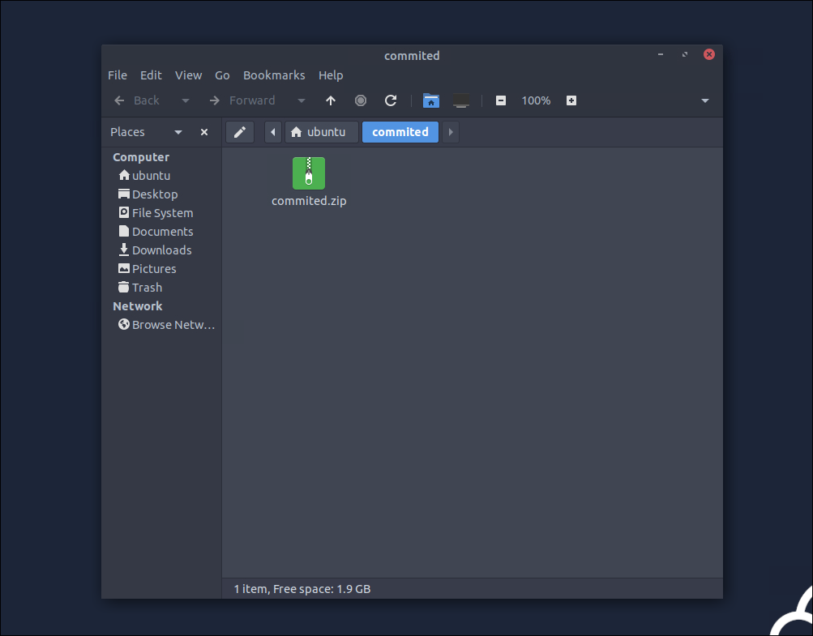
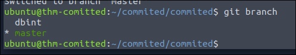
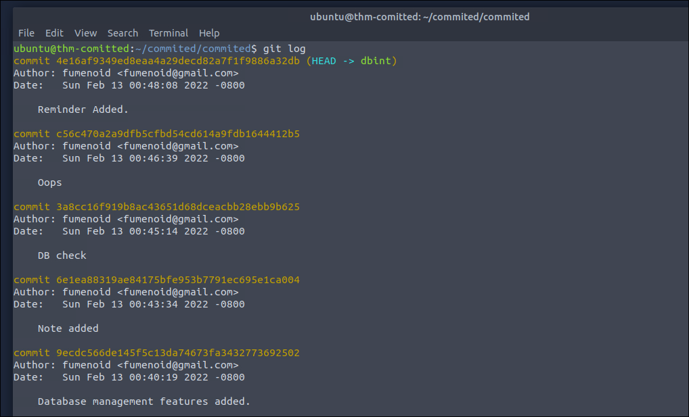

# Committed

- when we start the machine we can see a `ZIP file` that should contain the `repository`


- so we unzip it with: 
```bash
unzip commited.zip
```

- when we move into the extracted folder, called `committed`, we can see the `.git` folder that confirms that this is the `repository`: 
```bash
ubuntu@thm-comitted:~/commited/commited$ ls -la
total 20
drwxrwxr-x 3 ubuntu ubuntu 4096 Feb 13  2022 .
drwxrwxr-x 3 ubuntu ubuntu 4096 Nov  3 19:47 ..
drwxrwxr-x 8 ubuntu ubuntu 4096 Feb 13  2022 .git
-rw-rw-r-- 1 ubuntu ubuntu  393 Feb 13  2022 Readme.md
-rw-rw-r-- 1 ubuntu ubuntu  982 Feb 13  2022 main.py
```

- lets checkout the `main.py`: 
```python
import mysql.connector

def create_db():
    mydb = mysql.connector.connect(
    host="localhost",
    user="", # Username Goes Here
    password="" # Password Goes Here
    )

    mycursor = mydb.cursor()

    mycursor.execute("CREATE DATABASE commited")


def create_tables():
    mydb = mysql.connector.connect(
    host="localhost",
    user="", #username Goes here
    password="", #password Goes here
    database="commited"
    )

    mycursor = mydb.cursor()

    mycursor.execute("CREATE TABLE customers (name VARCHAR(255), address VARCHAR(255))")
...
```

- we can see that nothing is stored in the `user` and `password` variables, so not even a variabel from an `.env` file 
- after I found nothing in the commits on the `master`-branch, I thought that maybe there ist another `branch`:   


- lets switch to the `branch`: 
```bash
git switch dbint 
```

- lets look at the `commits`: 


- one `commit` stands out with the message `Oops`, lets check out the commit before this: 
```bash
git checkout 3a8cc16f919b8ac43651d68dceacbb28ebb9b625
```

- when we look at the `main.py` we can find the flag: 
```python
...
def populate_tables():
    mydb = mysql.connector.connect(
    host="localhost",
    user="root",
    password="<redacted>",
    database="commited"
    )

    mycursor = mydb.cursor()

    sql = "INSERT INTO customers (name, address) VALUES (%s, %s)"
    val = ("John", "Highway 21")
    mycursor.execute(sql, val)

    mydb.commit()

    print(mycursor.rowcount, "record inserted.")
...
```

